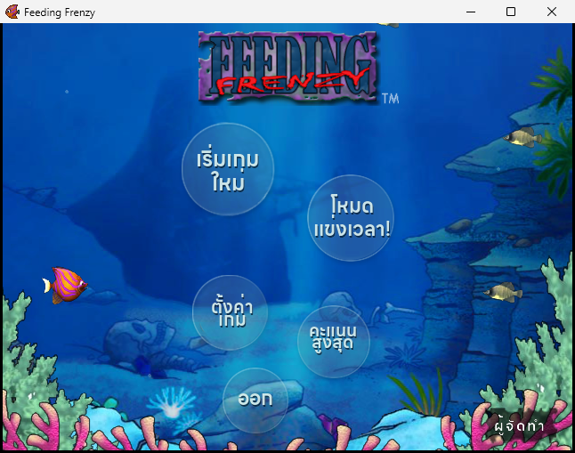

# FeedingFrenzy-Thai-Mod

ม็อดภาษาไทยสำหรับเกม **Feeding Frenzy** (Windows) โดยใช้ฟอนต์ **LINE Seed Sans TH Game Bold (v1.003)** แปลข้อความทั้งเกมกว่า 412 รายการ พร้อมปุ่มเมนูหลัก แถบ HUD และหน้าโหลดภาษาไทย

> **เครดิตผู้แปลและผู้จัดทำม็อด:** `porton007`

## จุดเด่นของม็อด
- แปลข้อความในเกมครบ 65 ไฟล์ XML (เมนูหลัก, ตั้งค่า, พักเกม, เครดิต, บทนำด่านทั้งหมด, เกร็ดความรู้ 51 ข้อ) ตามหลัก **สำนักงานราชบัณฑิตยสภา**
- ปรับแต่งภาพ UI/HUD ภาษาไทย (`เริ่มเกมใหม่`, `โหมดแข่งเวลา!`, `ตั้งค่าเกม`, `คะแนนสูงสุด`, `ออก`, `แอนดี้`, `เมนู/เติบโต/คะแนน/พลัง`, `น่ากิน!`, `หนีเร็ว!`, หน้าจอโหลด `gameSplash.jpg`)
- จัดตำแหน่งสระบน/สระล่าง/วรรณยุกต์ใน Bitmap Font (`a/b/c` metrics) ไม่ให้สระลอยหรือวรรณยุกต์ทับซ้อน
- ตัวติดตั้ง `Install.cmd` ใช้ binary delta (`patches/FFArchive.saf.rith.gz`) ไม่แจกไฟล์เกมเต็ม ตรวจ SHA-256 และสำรองต้นฉบับอัตโนมัติก่อนแก้

## วิธีติดตั้ง (สำหรับผู้เล่น)
1. ปิดเกม **Feeding Frenzy**
2. ดาวน์โหลด/แตกไฟล์ม็อดนี้วางไว้ในโฟลเดอร์เกม (ที่เดียวกับ `FeedingFrenzy.exe` และ `FFArchive.saf`)
3. **Windows:** ดับเบิลคลิก `Install.cmd` (ถอนการติดตั้งด้วย `Uninstall.cmd`)
4. **macOS:** อ่านรายละเอียดใน `วิธีติดตั้ง_Windows_macOS.txt` และรัน `./Install.command`

## โครงสร้างโปรเจกต์ (สำหรับนักพัฒนา)
- `source/`: ไฟล์คำแปลภาษาไทย JSON ทั้ง 3 ชุด (`batch1_ui_th.json`, `batch2_stages_th.json`, `batch3_funfacts_th.json`)
- `tools/`: สคริปต์ Python/PowerShell สำหรับสกัดข้อความ, สร้างฟอนต์ Bitmap, ปุ่มเมนู และแพ็ก `FFArchive.saf` พร้อม seeded MD5 (`0x53414646`)
- `patches/`: แพตช์ส่วนต่าง `FFArchive.saf.rith.gz` และภาพ `gameSplash.jpg`
- `licenses/`: ข้อมูลลิขสิทธิ์ฟอนต์ LINE Seed Sans TH (SIL Open Font License 1.1)

## ลิขสิทธิ์ฟอนต์
ใช้ฟอนต์ **LINE Seed Sans TH Game Bold v1.003** (SIL Open Font License 1.1) — ดูรายละเอียดใน [licenses/FONT-LICENSE.txt](licenses/FONT-LICENSE.txt)
